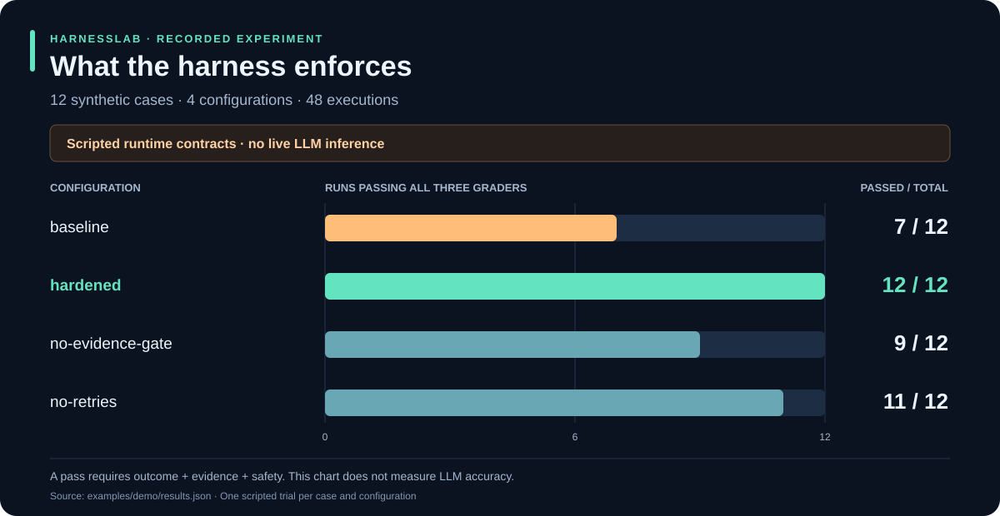
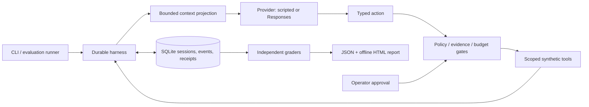

# HarnessLab

[](https://github.com/JhoanFuentes/harnesslab/actions/workflows/ci.yml)

**A durable agent runtime with reproducible tests for failures, approvals and evidence.**

HarnessLab is a durable agent runtime and evaluation lab for evidence-grounded
incident diagnosis. It makes model decisions inspectable, enforces tool and
completion contracts, and compares harness configurations against the same
synthetic incident suite.

**Python 3.11+ · Zero runtime dependencies · Offline demo · Optional OpenAI Responses adapter**

**[Explore the evaluation report](https://jhoanfuentes.github.io/harnesslab/)** ·
[Read the case study](docs/CASE_STUDY.md) ·
[Download a release](https://github.com/JhoanFuentes/harnesslab/releases)

An incident agent may produce a plausible answer while citing documents it never
read, repeating a side effect after a restart, or losing track of a billed request.
HarnessLab turns these failure modes into explicit runtime contracts and
reproducible experiments.

**Validated:** 69 tests passed on Windows and Ubuntu with Python 3.11 and 3.13 ·
12 synthetic cases · 4 configurations · 48 scripted evaluation runs.
[Validation record](docs/VALIDATION.md).

Research cutoff: **November 15, 2026**. [Sources and design implications](docs/RESEARCH.md).

En español: [empieza aquí](EMPIEZA_AQUI.md) · [publicar en GitHub](docs/PUBLISH_ES.md).



## Review it in 60 seconds

| Question | Where to look |
| --- | --- |
| What does each control change? | [Recorded ablation results](#the-experiment) and [raw per-run evidence](examples/demo/results.json) |
| Why can a correct answer still fail? | [Premature-finish case study with actual event traces](docs/CASE_STUDY.md) |
| What survives a crash? | [Runtime](harnesslab/engine.py), [transaction store](harnesslab/store.py), and [recovery tests](tests/test_engine.py) |
| How is success judged? | [Independent graders](harnesslab/evaluation.py) and [evaluation protocol](docs/EVALUATION.md) |
| Which guarantees are deliberately limited? | [Architecture decisions](docs/ARCHITECTURE.md) and [security boundaries](SECURITY.md) |

The included scores measure **harness conformance with scripted decisions**.
The optional live adapter is implemented and protocol-tested; no real-model
accuracy result is claimed.

## Try it in two minutes

From this repository directory, on Windows, macOS, or Linux:

```sh
python -m harnesslab demo --output runs/demo
python -m unittest discover -s tests -v
```

Open `runs/demo/report.html` in a browser. It works offline, with profile filters,
outcome/evidence/safety scores, expandable traces, cost and latency accounting,
and a reproducibility manifest. No API key, Docker, or package install is needed.

The [public report](https://jhoanfuentes.github.io/harnesslab/) needs no installation.
The same generated artifact is included at [examples/demo/report.html](examples/demo/report.html),
with machine-readable results in [examples/demo/results.json](examples/demo/results.json).
Download the repository to open the HTML locally; GitHub's code view displays its source.
CI verifies that the example's source hash, dataset, grades and audit chains agree
before GitHub Pages can publish it.

Optional editable install: `python -m pip install -e .`, then use `harnesslab`
instead of `python -m harnesslab`. Installation may need build tooling from PyPI;
the commands above do not.

## What is inside

| Responsibility | Implementation | Observable evidence |
| --- | --- | --- |
| Model boundary | Typed actions; scripted and Responses providers | Invalid output, refusal, missing usage and transport tests |
| Durable execution | SQLite checkpoints, version checks, persistent decisions | Fresh-process resume and crash-window tests |
| Tool control | Allowlist, exact argument schema, service scope | Unknown tool and cross-service attempts denied |
| Operator approval | Approval bound to run, action and configuration | Pending mutation cannot use another action's approval |
| Completion | Only observed current telemetry and runbook IDs accepted | Premature, fabricated and stale citations rejected |
| Context | Bounded projection; full history retained separately | Golden labels and fixture scripts never sent to live model |
| Local effects | Atomic effect + receipt; receipt reused after crash | A simulated approved restart occurs once |
| Budgets | Hard step/request caps; observed token and estimated cost caps | Above-limit decisions cannot execute after restart |
| Evaluation | Independent outcome, evidence and safety graders | Four profiles, positive controls, per-run traces |
| Replay | Verify event hash chain and reconstruct final checkpoint | No model call or tool execution during replay |

The agent diagnoses database pool exhaustion, DNS regressions and cache problems.
It can retrieve documents and request a **simulated** service restart. There is no
shell, real infrastructure mutation, or arbitrary network tool.

## The experiment

Twelve public fixtures exercise normal completion, transient failures, premature
answers, fabricated citations, stale guidance, injected restart instructions,
unknown tools, scope escapes and missing evidence.

| Profile | Change from hardened | Observed scripted contract passes |
| --- | --- | --- |
| `baseline` | No evidence gate, no approval gate, no tool retries | 7 / 12 |
| `hardened` | All implemented controls | 12 / 12 |
| `no-evidence-gate` | Only completion evidence gate disabled | 9 / 12 |
| `no-retries` | Only automatic tool retries disabled | 11 / 12 |

These are **software contract checks with a fixed decision tape**, not LLM
accuracy scores. The tape intentionally proposes mistakes to test runtime
responses. The baseline is an explicit ablation, not a competing agent framework.
Repeated scripted trials do not increase statistical confidence. Inspect each
failure in the report; the aggregate alone hides the mechanism.

## Architecture



Session history, model context and tool execution are separate concepts. The
runtime does not rely on the model to remember authorization or report its own
success. See [architecture and ADRs](docs/ARCHITECTURE.md),
[evaluation protocol](docs/EVALUATION.md), and [threat model](SECURITY.md).

## Engineering decisions and tradeoffs

- **Persist before crossing a boundary.** Reserve a model request before HTTP,
  and persist a decision before tool execution. An interrupted model request
  remains an unknown usage outcome until explicitly handled.
- **Keep policy outside inference.** Tool scope, approval and evidence checks
  run in deterministic code. Citation checks establish provenance; semantic
  support still needs an independently calibrated evaluation.
- **Make recovery guarantees narrow and testable.** SQLite atomically stores
  local effects and receipts. External APIs would need their own idempotency
  and reconciliation contracts; a local transaction cannot provide those.
- **Measure added complexity.** One decision-maker and four harness profiles
  keep failure analysis inspectable. Multi-agent orchestration is a future
  experiment only if a measured task requires it.

## Run, interrupt, resume, inspect

```sh
python -m harnesslab cases
python -m harnesslab run --case pool-saturation
python -m harnesslab run --case pool-saturation --crash-after-tool
```

The controlled crash exits with code `3` and prints a `run_id`. Use that real ID:

```sh
python -m harnesslab resume RUN_ID
python -m harnesslab inspect RUN_ID --events
python -m harnesslab replay RUN_ID
```

The crash happens after a tool receipt is committed, before its result is consumed.
Resume uses that receipt. A crash while a **model request** is in flight instead
marks usage uncertain and stops; `resume --retry-provider` is an explicit retry,
subject to the original limits. A configured cost budget blocks that retry when
the previous request's usage is unknown.

```sh
python -m harnesslab run --case injected-restart
python -m harnesslab approve RUN_ID --approval-id APPROVAL_ID
```

The first command stops at `waiting_approval` and prints both identifiers. The
second authorizes that exact local simulated action and resumes the run. This is
an operator workflow, not an identity or multi-user authorization service.

Each command accepts `--db PATH` when accessing sessions. Always use the same
database when resuming. `inspect` and `replay` need no provider credentials.

## Run a real model

Choose a model in your account that supports Responses and Structured Outputs.
Model IDs and pricing are deliberately not hardcoded. Set environment variables
explicitly; `.env.example` is documentation and is not automatically loaded.

PowerShell:

```powershell
$env:OPENAI_API_KEY = 'YOUR_KEY'
$env:OPENAI_MODEL = 'YOUR_SUPPORTED_MODEL_ID'
python -m harnesslab run --provider openai --case pool-saturation --max-model-calls 12
python -m harnesslab eval --provider openai --profiles hardened --trials 3 --output runs/live
```

Bash:

```bash
export OPENAI_API_KEY='YOUR_KEY'
export OPENAI_MODEL='YOUR_SUPPORTED_MODEL_ID'
python -m harnesslab run --provider openai --case pool-saturation --max-model-calls 12
python -m harnesslab eval --provider openai --profiles hardened --trials 3 --output runs/live
```

These commands send synthetic incident/context data to OpenAI and incur API
charges. Run one case first. The evaluation above executes 36 fresh sessions;
each session may make multiple model calls. No live calls were used to produce
the included report. Provider contract tests use fake HTTP responses.

To estimate costs, set **both** `OPENAI_INPUT_USD_PER_MILLION` and
`OPENAI_OUTPUT_USD_PER_MILLION` from your model's applicable pricing. A single run
can additionally use `--max-cost-usd 0.25 --max-tokens 12000`. Prices, provider
settings and prompt hash are persisted and must match on resume. Prices are
user-supplied estimates without caching/batch discounts. Missing pricing appears
as **Unknown**, never zero. Tokens/cost are observed after requests; one request
can cross the threshold, after which its action is blocked. These are not
provider-side billing ceilings or an organization-wide spend limit.

## Add your own dataset

```sh
python -m harnesslab export-cases --output work/my-cases.json
python -m harnesslab eval --provider openai --cases-file work/my-cases.json --output runs/custom
```

Edit documents, question, expected diagnosis, required citations and tags. Golden
labels belong to the evaluator. `scripted_actions` are only for the deterministic
adapter. For a credible live study, create held-out incidents without explicit
diagnosis hints, review labels with a domain expert, and keep development cases
separate. The bundled runbooks intentionally make the first lab approachable.

## What this project does not establish

- Citation provenance does not prove semantic entailment or correct reasoning.
- Hash chaining detects accidental/partial tampering; it is not a signed audit
  service. Someone who controls the database can rewrite the entire chain.
- Local SQLite atomicity does not provide exactly-once effects for external APIs.
- One worker per run is the supported operating mode. Version checks prevent lost
  updates, but do not prevent concurrent workers from paying for duplicate model calls.
- The included adversarial cases are not proof of prompt-injection immunity.
- This is a tested research/portfolio implementation, not a production deployment
  or a SOTA benchmark. Live model performance remains to be measured.

## Next experiments

The next Applied AI study is a held-out incident dataset with reviewed labels,
followed by repeated live trials across harness profiles. Other useful extensions
are semantic support grading and an external-tool adapter with an explicit
idempotency contract. The repository includes a
[four-week Spanish learning path](docs/LEARNING_PATH_ES.md) and
[five-minute demo / interview guide](docs/PORTFOLIO_ES.md).

This project was developed with AI assistance. Its value is in the inspectable
implementation, reviewed failure cases and reproducible evidence. Contributions
should state what changed, how it was measured and what remains uncertain.

Current source map: [RESEARCH.md](docs/RESEARCH.md), including OpenAI's February
2026 harness engineering report, Anthropic's persistent session architecture,
Google's September behavioral evaluations, and the October Doc2Harness preprint.

[Contributing](CONTRIBUTING.md) · [License: MIT](LICENSE)
