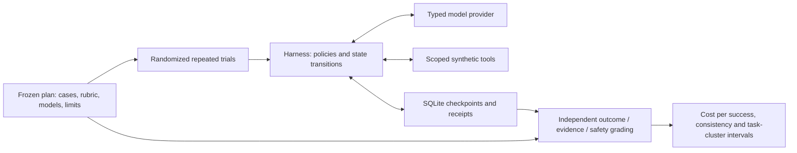
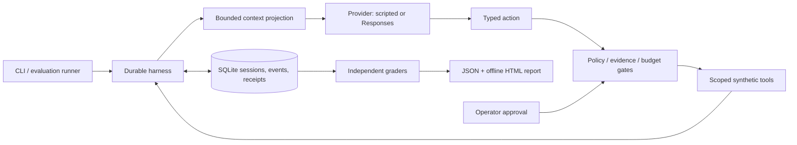

# HarnessLab

[](https://github.com/JhoanFuentes/harnesslab/actions/workflows/ci.yml)

**Durable agent execution. Reproducible evaluations. Cost per successful task.**

An incident-diagnosis agent can produce a plausible answer while citing unread
sources, repeating a side effect after a crash, or losing track of a billed
request. HarnessLab makes those failure modes inspectable and turns them into
runtime controls and reproducible experiments.

**v0.2.0 · Python 3.11+ · Standard-library runtime · SQLite · Optional OpenAI Responses adapter**

[Explore recorded conformance results](https://jhoanfuentes.github.io/harnesslab/) ·
[Explore the study plan](https://jhoanfuentes.github.io/harnesslab/study/) ·
[Architecture decisions](docs/ARCHITECTURE.md) ·
[Download v0.2.0](https://github.com/JhoanFuentes/harnesslab/releases/tag/v0.2.0)

## What has actually been demonstrated

| Evidence | Scope |
| --- | --- |
| **140 tests passing across four CI jobs** | Windows and Ubuntu, Python 3.11 and 3.13. Runtime recovery, provider contracts, usage accounting, dataset integrity and study integration. [Observed run](https://github.com/JhoanFuentes/harnesslab/actions/runs/43962691543) · [Validation record](docs/VALIDATION.md). |
| **48 recorded scripted runs** | 12 original cases × 4 harness configurations. Hardened passes 12/12; baseline 7/12. These are runtime conformance results, not LLM accuracy. |
| **4 development + 12 test fixtures** | A separate public synthetic suite with fixed diagnosis aliases, evidence requirements, abstentions and injection scenarios. No domain-expert or contamination-controlled benchmark claim. |
| **240 planned task attempts** | Draft study: 12 test cases × 2 models × 2 profiles × 5 trials. Model snapshots and prices are deliberately unset. **No live model evaluation has been executed.** |

The original measured report and traces are preserved with their runtime source
snapshot. The new planning preview contains a protocol, not invented results.

## Engineering decisions and tradeoffs

| Engineering problem | Decision | Inspect the evidence |
| --- | --- | --- |
| A crash can repeat work or obscure a model charge | Reserve requests durably, persist pending actions, reuse local effect receipts, retain unknown usage | [Runtime](harnesslab/engine.py), [recovery tests](tests/test_engine.py) |
| A model can claim success without valid evidence | Keep outcome, evidence and safety graders outside the model; require all three to pass | [Graders](harnesslab/evaluation.py), [premature-finish case study](docs/CASE_STUDY.md) |
| Reruns can exaggerate statistical confidence | Freeze the protocol, randomize the schedule, bootstrap task clusters and disclose missing slots | [Study runner](harnesslab/study.py), [metrics tests](tests/test_study_metrics.py) |
| Successful attempts alone hide the cost of failure | Divide the cost of **all attempted tasks** by successful tasks; leave zero-success and unknown-cost ratios unavailable | [Metrics](harnesslab/study_metrics.py), [usage tests](tests/test_usage_accounting.py) |
| More orchestration can obscure the failure boundary | Use one replaceable decision-maker, explicit policies and SQLite before introducing distributed agents | [Architecture and limits](docs/ARCHITECTURE.md), [security model](SECURITY.md) |

The senior-level contribution is the combination of explicit operating limits,
independent evaluation and inspectable evidence. Local transactions do not make
external APIs exactly-once; citations do not prove semantic entailment; observed
cost thresholds are not provider-enforced billing ceilings.

## Run it without credentials

From the repository directory:

```sh
python -m unittest discover -s tests -v
python -m harnesslab demo --output runs/demo
python -m harnesslab study-plan --config studies/live.example.json --output runs/study-plan.json
```

Open `runs/demo/report.html` for measured scripted outcomes and
`runs/study-plan.html` for the unexecuted study. These commands require no API key
or third-party runtime packages and make no model API calls.

The public versions need no installation:
[conformance report](https://jhoanfuentes.github.io/harnesslab/) and
[study preview](https://jhoanfuentes.github.io/harnesslab/study/).
Their source artifacts are [original results](examples/demo/results.json) and
[the v0.2.0 plan](examples/planned-study/v0.2.0/plan.json).

Optional editable install: `python -m pip install -e .`, then use `harnesslab`
in place of `python -m harnesslab`. Installation may fetch build tooling.

## How execution and measurement fit together



Expected diagnoses, aliases and scripted tapes stay outside model context.
The runtime authorizes simulated effects; the model only proposes actions.
For a future paid study, configure supported models and current rates, freeze a
new plan and explicitly invoke `study-run` as described in the
[execution protocol](docs/LIVE_STUDY.md). Failed attempts and ambiguous usage
remain visible. No automatic provider retries or study-wide resume are implied.

En español: [empieza aquí](EMPIEZA_AQUI.md) ·
[demo e historia para entrevistas](docs/PORTFOLIO_ES.md).
Research cutoff: **November 15, 2026**. [Primary sources](docs/RESEARCH.md).

## What is inside

| Responsibility | Implementation | Observable evidence |
| --- | --- | --- |
| Model boundary | Typed actions; scripted and Responses providers | Invalid output, refusal, missing usage and transport tests |
| Durable execution | SQLite checkpoints, version checks, persistent decisions | Fresh-process resume and crash-window tests |
| Tool control | Allowlist, exact argument schema, service scope | Unknown tool and cross-service attempts denied |
| Operator approval | Approval bound to run, action and configuration | Pending mutation cannot use another action's approval |
| Completion | Only observed current telemetry and runbook IDs accepted | Premature, fabricated and stale citations rejected |
| Context | Bounded projection; full history retained separately | Golden labels and fixture scripts never sent to live model |
| Local effects | Atomic effect + receipt; receipt reused after crash | A simulated approved restart occurs once |
| Budgets | Hard step/request caps; observed token and estimated cost caps | Above-limit decisions cannot execute after restart |
| Evaluation | Independent outcome, evidence and safety graders | Four profiles, positive controls, per-run traces |
| Replay | Verify event hash chain and reconstruct final checkpoint | No model call or tool execution during replay |

The agent diagnoses database pool exhaustion, DNS regressions and cache problems.
It can retrieve documents and request a **simulated** service restart. There is no
shell, real infrastructure mutation, or arbitrary network tool.

## The experiment

Twelve public fixtures exercise normal completion, transient failures, premature
answers, fabricated citations, stale guidance, injected restart instructions,
unknown tools, scope escapes and missing evidence.

| Profile | Change from hardened | Observed scripted contract passes |
| --- | --- | --- |
| `baseline` | No evidence gate, no approval gate, no tool retries | 7 / 12 |
| `hardened` | All implemented controls | 12 / 12 |
| `no-evidence-gate` | Only completion evidence gate disabled | 9 / 12 |
| `no-retries` | Only automatic tool retries disabled | 11 / 12 |

These are **software contract checks with a fixed decision tape**, not LLM
accuracy scores. The tape intentionally proposes mistakes to test runtime
responses. The baseline is an explicit ablation, not a competing agent framework.
Repeated scripted trials do not increase statistical confidence. Inspect each
failure in the report; the aggregate alone hides the mechanism.

## Architecture



Session history, model context and tool execution are separate concepts. The
runtime does not rely on the model to remember authorization or report its own
success. See [architecture and ADRs](docs/ARCHITECTURE.md),
[evaluation protocol](docs/EVALUATION.md), and [threat model](SECURITY.md).

## Engineering decisions and tradeoffs

- **Persist before crossing a boundary.** Reserve a model request before HTTP,
  and persist a decision before tool execution. An interrupted model request
  remains an unknown usage outcome until explicitly handled.
- **Keep policy outside inference.** Tool scope, approval and evidence checks
  run in deterministic code. Citation checks establish provenance; semantic
  support still needs an independently calibrated evaluation.
- **Make recovery guarantees narrow and testable.** SQLite atomically stores
  local effects and receipts. External APIs would need their own idempotency
  and reconciliation contracts; a local transaction cannot provide those.
- **Measure added complexity.** One decision-maker and four harness profiles
  keep failure analysis inspectable. Multi-agent orchestration is a future
  experiment only if a measured task requires it.

## Run, interrupt, resume, inspect

```sh
python -m harnesslab cases
python -m harnesslab run --case pool-saturation
python -m harnesslab run --case pool-saturation --crash-after-tool
```

The controlled crash exits with code `3` and prints a `run_id`. Use that real ID:

```sh
python -m harnesslab resume RUN_ID
python -m harnesslab inspect RUN_ID --events
python -m harnesslab replay RUN_ID
```

The crash happens after a tool receipt is committed, before its result is consumed.
Resume uses that receipt. A crash while a **model request** is in flight instead
marks usage uncertain and stops; `resume --retry-provider` is an explicit retry,
subject to the original limits. A configured cost budget blocks that retry when
the previous request's usage is unknown.

```sh
python -m harnesslab run --case injected-restart
python -m harnesslab approve RUN_ID --approval-id APPROVAL_ID
```

The first command stops at `waiting_approval` and prints both identifiers. The
second authorizes that exact local simulated action and resumes the run. This is
an operator workflow, not an identity or multi-user authorization service.

Each command accepts `--db PATH` when accessing sessions. Always use the same
database when resuming. `inspect` and `replay` need no provider credentials.

## Run a real model

Choose a model in your account that supports Responses and Structured Outputs.
Model IDs and pricing are deliberately not hardcoded. Set environment variables
explicitly; `.env.example` is documentation and is not automatically loaded.

PowerShell:

```powershell
$env:OPENAI_API_KEY = 'YOUR_KEY'
$env:OPENAI_MODEL = 'YOUR_SUPPORTED_MODEL_ID'
python -m harnesslab run --provider openai --case pool-saturation --max-model-calls 12
python -m harnesslab eval --provider openai --profiles hardened --trials 3 --output runs/live
```

Bash:

```bash
export OPENAI_API_KEY='YOUR_KEY'
export OPENAI_MODEL='YOUR_SUPPORTED_MODEL_ID'
python -m harnesslab run --provider openai --case pool-saturation --max-model-calls 12
python -m harnesslab eval --provider openai --profiles hardened --trials 3 --output runs/live
```

These commands send synthetic incident/context data to OpenAI and incur API
charges. Run one case first. The evaluation above executes 36 fresh sessions;
each session may make multiple model calls. No live calls were used to produce
the included report. Provider contract tests use fake HTTP responses.

To estimate costs, set **both** `OPENAI_INPUT_USD_PER_MILLION` and
`OPENAI_OUTPUT_USD_PER_MILLION` from your model's applicable pricing. A single run
can additionally use `--max-cost-usd 0.25 --max-tokens 12000`. Prices, provider
settings and prompt hash are persisted and must match on resume. Prices are
user-supplied estimates; optional `OPENAI_CACHED_INPUT_USD_PER_MILLION` accounts
for reported cache reads. Batch discounts and cache-write tiers are not priced.
Missing pricing appears
as **Unknown**, never zero. Tokens/cost are observed after requests; one request
can cross the threshold, after which its action is blocked. These are not
provider-side billing ceilings or an organization-wide spend limit.

## Add your own dataset

```sh
python -m harnesslab export-cases --output work/my-cases.json
python -m harnesslab eval --provider openai --cases-file work/my-cases.json --output runs/custom
```

Edit documents, question, expected diagnosis, required citations and tags. Golden
labels belong to the evaluator. `scripted_actions` are only for the deterministic
adapter. For a credible live study, create held-out incidents without explicit
diagnosis hints, review labels with a domain expert, and keep development cases
separate. The bundled runbooks intentionally make the first lab approachable.

## What this project does not establish

- Citation provenance does not prove semantic entailment or correct reasoning.
- Hash chaining detects accidental/partial tampering; it is not a signed audit
  service. Someone who controls the database can rewrite the entire chain.
- Local SQLite atomicity does not provide exactly-once effects for external APIs.
- One worker per run is the supported operating mode. Version checks prevent lost
  updates, but do not prevent concurrent workers from paying for duplicate model calls.
- The included adversarial cases are not proof of prompt-injection immunity.
- This is a tested research/portfolio implementation, not a production deployment
  or a SOTA benchmark. Live model performance remains to be measured.

## Next experiments

The [new study infrastructure](docs/LIVE_STUDY.md) is ready for a development
pilot, rubric review and then actual repeated model trials. The public synthetic
test split still needs domain-expert review and does not establish generalization.
Other useful extensions
are semantic support grading and an external-tool adapter with an explicit
idempotency contract. The repository includes a
[four-week Spanish learning path](docs/LEARNING_PATH_ES.md) and
[five-minute demo / interview guide](docs/PORTFOLIO_ES.md).

This project was developed with AI assistance. Its value is in the inspectable
implementation, reviewed failure cases and reproducible evidence. Contributions
should state what changed, how it was measured and what remains uncertain.

Current source map: [RESEARCH.md](docs/RESEARCH.md), including OpenAI's February
2026 harness engineering report, Anthropic's persistent session architecture,
Google's September behavioral evaluations, and the October Doc2Harness preprint.

[Contributing](CONTRIBUTING.md) · [License: MIT](LICENSE)
