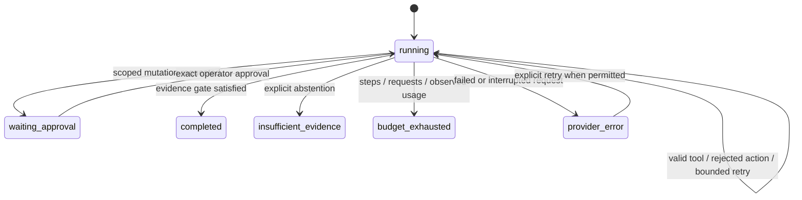

# Architecture and decision records

## System boundaries

`models.py` is the dependency-free contract layer. `providers.py` proposes typed
actions. `engine.py` owns all policy, state progression and completion decisions.
`store.py` owns SQLite transactions. `evaluation.py` grades completed environment
state independently. `report.py` renders escaped, self-contained HTML. `cli.py`
orchestrates these components without containing business policy.

The live provider receives task question/service, evidence metadata, bounded
recent observations, feedback and remaining output allowance. It never receives
expected diagnoses, required evidence labels, scripts or approval identifiers.
Credentials stay in the provider object and HTTP Authorization header. They do
not enter documents, model context, checkpoints or report manifests.

## Lifecycle

Every model request is reserved durably before HTTP. The result is persisted as
a pending typed action before tool execution. A restart reuses that action. If
a process dies between request reservation and durable response, the request
outcome is ambiguous: resume stops and marks usage incomplete. Known reported
cost remains available, while total estimated cost becomes unknown.

Tools first validate an allowlist, exact argument keys/types and incident service
scope. The policy gate remains present in every profile. Only the approval,
evidence and retry mechanisms vary in documented ablations.

## ADR 001: Separate durable session from context projection

**Decision:** keep the full checkpoint/event history in SQLite; construct a
deterministic character-bounded projection for each request. Preserve stable
evidence IDs and current/stale metadata before recent observations.

**Why:** losing a process or trimming model input must not erase system state.
Character limits are simple and portable; they are not tokenizer-aware. The
prompt has overhead outside the projection and the API reports authoritative
usage afterward. Oversized observations are explicitly marked truncated.

**Tradeoff:** a very small window may hide useful evidence. The context does not
promise arbitrary document navigation or semantic memory. Test context budgets
as a separate live experiment before choosing a production policy.

## ADR 002: SQLite receipts for local idempotence

**Decision:** persist each local effect and receipt in the same transaction as a
`tool_committed` event. The key derives from run ID, step and exact action. After
restarting, consume the existing receipt rather than performing the effect again.

**Why:** it exposes a real recovery boundary without introducing a distributed
queue or database server. WAL, foreign keys, full synchronous commits and
optimistic versions make the local guarantee explicit.

**Tradeoff:** this applies only to the synthetic local tools. An external effect
needs target-side idempotency or an outbox/reconciliation design. Wrapping an
HTTP call in a SQLite transaction cannot make that remote call atomic. SQLite
is not encrypted; sessions should contain only data appropriate for local disk.

## ADR 003: Runtime completion gate plus independent grader

**Decision:** a non-abstaining finish must cite observed current telemetry and
a current runbook. The grader separately checks fixture-specific diagnosis,
required evidence and actual simulated effects.

**Why:** the model's statement that it succeeded is not evidence of success.
Runtime checks do not consult hidden golden answers. Tests include positive
controls so a policy that blocks everything cannot pass the suite.

**Tradeoff:** IDs and freshness do not prove that a diagnosis follows from the
document. Exact label grading is intentionally narrow; a semantic grader and
calibration set would be a measured extension, not a drop-in proof of truth.

## ADR 004: One agent, replaceable model, measured ablations

**Decision:** use one decision-maker with a `Provider` protocol. Scripted tapes
isolate runtime behavior; an optional Responses adapter evaluates model behavior.
Do not introduce planner/worker/critic agents before a measured need.

**Why:** changing one harness mechanism at a time makes failures interpretable.
The simple baseline removes multiple mechanisms, while single-control ablations
identify more specific effects. No external agent framework is claimed inferior.

**Tradeoff:** scripts are not an adaptive model. The public suite is small and
contains helpful runbook hints. Live conclusions require held-out tasks, repeated
trials, reviewed labels, paired configuration comparisons and failure inspection.

## ADR 005: Honest accounting and replay semantics

**Decision:** steps and model requests have pre-action/pre-request hard caps.
Token/cost thresholds use returned usage and stop actions after an overrun;
the crossing request may already be billed. Model requests are never implicitly
retried. Deterministic local transient tool failures have bounded retries.

**Why:** duplicate requests after network failure can hide costs. An unknown
amount is represented as unknown, not free. Resuming with changed prices,
request settings or prompt version is rejected.

`replay` verifies chained event hashes and compares the reconstructed latest
checkpoint with the stored state. It does not replay inference or demonstrate
that the same LLM would make the same decisions. The log is append-only through
this API, not physically immutable or externally signed.

## ADR 006: Freeze the study before inference

`study.py` adds a separate plan/execute workflow around the same runtime. Plans
contain dataset/rubric, source and prompt hashes, rates, limits and a seeded
shuffled schedule. Plan creation cannot invoke a provider. Each execution uses
a new directory, preserves failed attempts and discloses missing slots.

`study_metrics.py` computes failure-inclusive cost per success and bootstraps
case clusters with their trials together. `study_report.py` explicitly labels
planning and injected offline-test artifacts. The new study rubric adds only
frozen exact aliases; it does not leak gold labels or replace provenance checks
with a model's own confidence. Inference quality remains unmeasured until a real
study is executed. See [protocol and operating limits](LIVE_STUDY.md).

The original scripted report retains its source snapshot and original traces.
It can be reverified after the active runtime evolves without claiming a new
measurement happened on the original date.

## Scaling path

Before a production pilot: define target data and success criteria, evaluate a
real model on held-out incidents, add authenticated approvals, tenant separation,
encrypted/redacted storage, provider-side spend controls and a real observability
export. Then decide whether distributed leases and a server database are needed.
These are intentionally future changes; the current project does not claim them.
