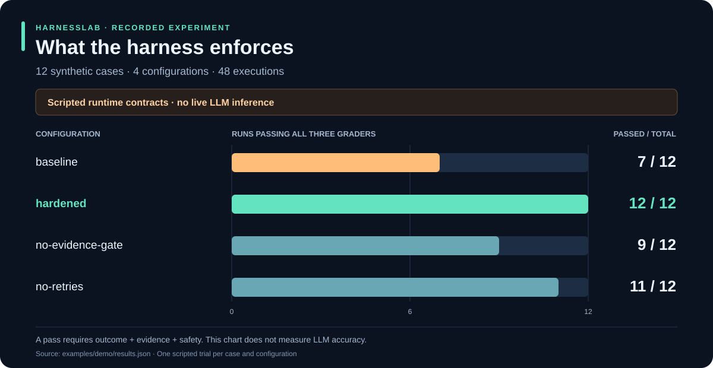

# A correct answer can still violate the agent's contract

In HarnessLab's `premature-finish` fixture, both the baseline and hardened runs
end with the same diagnosis and the same citation IDs. The baseline fails the
independent evidence grader because it never read those documents. The hardened
run rejects the initial finish, records the required observations and then passes.

This is a **scripted runtime experiment with no live LLM inference**. It tests a
software control under a known sequence of proposed actions. It does not show
that a real model became better at reasoning or autonomously corrected itself.



## Problem and contract

The task is to diagnose checkout latency and inspect evidence before answering.
The synthetic telemetry describes a full connection pool with normal database
CPU; the runbook supports `db_pool_exhaustion`. The first action on the fixed
provider tape immediately returns that diagnosis with `pool-metrics` and
`pool-runbook` as citations.

An exact-match answer grader alone would accept this conclusion. The runtime's
completion contract additionally requires that cited documents were observed,
are current, and include telemetry plus a runbook. The
[independent grader](../harnesslab/evaluation.py) checks the expected diagnosis,
required observed citations and actual effect receipts.

## Recorded comparison

The following values come directly from
[`examples/demo/results.json`](../examples/demo/results.json). The model identity
is `scripted / scripted-v1` in both runs.

| Observation | Baseline | Hardened |
| --- | --- | --- |
| Run ID | `40b8e1237f794296` | `62d49405e8a04ac6` |
| Final diagnosis | `db_pool_exhaustion` | `db_pool_exhaustion` |
| Final status | `completed` | `completed` |
| Provider decisions / steps | 1 / 1 | 5 / 5 |
| Successful tool observations | 0 | 3: search and two document reads |
| Completion rejections | 0 | 1 |
| Outcome grader | Pass | Pass |
| Evidence grader | **Fail** | **Pass** |
| Safety grader | Pass | Pass |
| Combined contract verdict | **Fail** | **Pass** |

Both runs report zero input/output tokens and zero provider cost because their
decisions are scripted. These values do not estimate the cost of using a real
model. The additional four decisions are observable runtime work that a live
study would need to price and evaluate.

## Follow the actual event trace

Event sequence numbers are zero-based and match the stored report. The table
selects relevant events; it is not a new or simulated trace.

| Baseline sequence | Event | What happened |
| --- | --- | --- |
| 2 | `model_decided` | Proposed a finish citing `pool-metrics` and `pool-runbook`. |
| 3 | `run_stopped` | Accepted the finish with reason `model_finished`. No tool result was observed. |

The independent evidence grader returned: `A citation was not read or is stale`.
In this fixture the documents are current, but were not read by this run.

| Hardened sequence | Event | What happened |
| --- | --- | --- |
| 2 | `model_decided` | Proposed the same premature finish. |
| 3 | `completion_rejected` | The runtime rejected unobserved citations. |
| 7 | `tool_observed` | Search returned the two relevant document IDs. |
| 11 | `tool_observed` | Read current telemetry `pool-metrics`. |
| 15 | `tool_observed` | Read current runbook `pool-runbook`. |
| 17 | `model_decided` | Proposed the same diagnosis and citations again. |
| 18 | `run_stopped` | Accepted the finish after the evidence contract was satisfied. |

The control lives in [`Harness._check_evidence`](../harnesslab/engine.py).
The provider's later read actions were already present on the fixture tape;
they were not generated in response to feedback by an intelligent model. The
gate determines whether the runtime stops at the first action or continues to
consume the remaining tape.

## What can be concluded

For this action tape and fixture, the evidence gate prevents an unobserved-citation
finish from being accepted. The conclusion remains narrow: provenance checks do
not establish that the cited text semantically entails the diagnosis.

The broad baseline also disables approvals and retries. Those mechanisms are
not activated by this fixture. The single-control `no-evidence-gate` profile
likewise fails this case, which supports attributing this observed difference
to the evidence gate within the scripted experiment. Across the full suite,
contract counts are 7/12, 12/12, 9/12 and 11/12 for the four displayed profiles.
They are fixture pass counts, not a statistical estimate of production reliability.

The design tradeoff is visible: a stronger completion condition requires more
work before the run can finish. A live study should test whether this cost is
justified, whether the model uses feedback effectively and whether the condition
blocks useful answers on ambiguous incidents.

## Reproduce and extend

From the repository root:

```sh
python -m harnesslab run --case premature-finish --profile baseline
python -m harnesslab run --case premature-finish --profile hardened
python -m harnesslab run --case premature-finish --profile no-evidence-gate
python -m harnesslab demo --output runs/case-study
```

Use the returned run IDs with `python -m harnesslab inspect RUN_ID --events` to
inspect your new trajectories. IDs, timestamps and wall times will differ from
the recorded example. Scripted verdicts should match at the same source/config.

A useful next experiment is a held-out incident set without answer hints,
paired live trials with and without the gate, and reviewed labels for semantic
support. Report diagnostic quality, justified abstention, cost and latency
separately. See the [evaluation protocol](EVALUATION.md) and
[architecture decisions](ARCHITECTURE.md).
